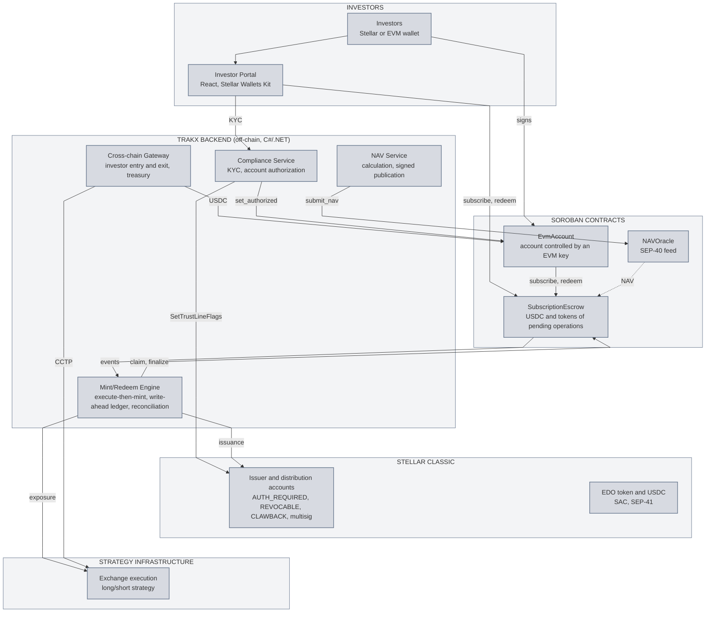
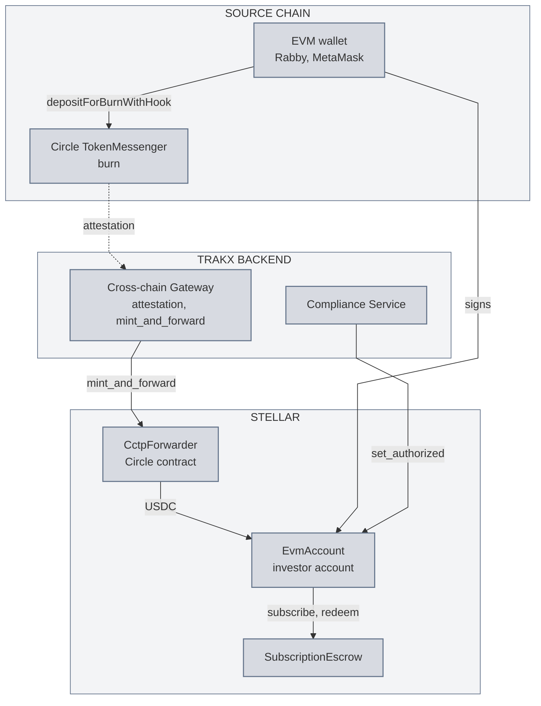
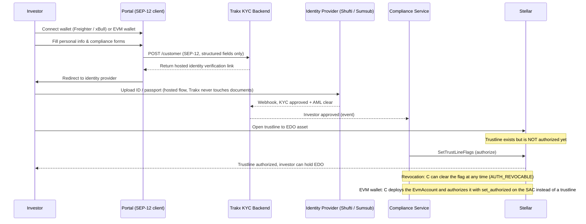
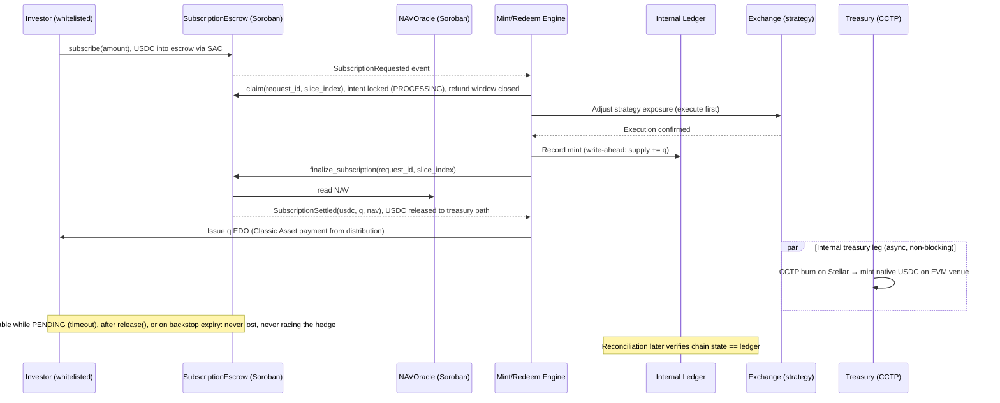
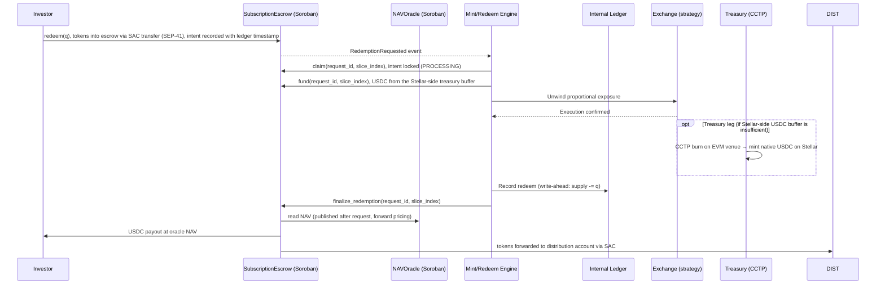

# Technical Architecture: Stellar Strategy Rails

**Product:** Tokenized wrapper for the EDO Theory automated long/short strategy
**Chain:** Stellar, hybrid architecture: Classic Asset for the token, Soroban smart contracts for on-chain logic
**Settlement asset:** native USDC on Stellar, whichever chain the investor comes from
**Issuer:** Trakx SAS (Paris). Trakx operated its crypto index platform as a digital asset service provider registered with the French AMF (the first company registered for four services) until June 30, 2026, when the end of the MiCA transition period closed the PSAN regime for the whole market; that retail activity was closed on that date. The strategy tokens are not crypto-assets under MiCA: they are financial instruments, governed by MiFID II. An issuer has no MiFID licence to obtain; the framework rests on three elements, which this architecture enforces: securities recorded on a distributed ledger, distribution through licensed intermediaries (Trakx's partner brokers, neobanks and advisers, who perform KYC and suitability checks), and access restricted to eligible investors, enforced on-chain by account authorization. The issuing entity and its DLT market infrastructure partner are named in the offering documents.
**Repository:** [github.com/trakx/stellar-strategy-rails](https://github.com/trakx/stellar-strategy-rails); the NAVOracle is implemented there (Rust, 31 tests), the rest is specified here.

---

## 1. Design principles

1. **Hybrid architecture: Classic for value, Soroban for logic.** The strategy token is a Stellar Classic Asset with `AUTH_REQUIRED`, `AUTH_REVOCABLE` and `AUTH_CLAWBACK_ENABLED` flags: investor access control enforced at protocol level, with battle-tested security and minimal fees for transfers. All programmable logic that belongs on-chain lives in Soroban smart contracts: the **NAVOracle** and the **SubscriptionEscrow**. Contracts interact with the Classic Asset through its built-in Stellar Asset Contract (SAC) interface.
2. **Execute-then-mint.** Tokens are only issued after the corresponding strategy exposure has been adjusted. Every token in circulation is therefore fully backed by the underlying position at all times. There are no liquidity pools and no on-chain market making: the chain is a distribution and ownership registry, not a liquidity venue. Two authorized holders may transfer the token between themselves, since both passed the same checks; we list the token nowhere and provide no liquidity.
3. **NAV computed off-chain, verifiable on-chain.** NAV is calculated off-chain by the same engine pricing Trakx's indices today (constituent prices, accrued fees, management fees), then published to the Soroban NAVOracle as a signed submission. The oracle is the single on-chain pricing reference for all mint/redeem operations, and a composable price feed any other Soroban protocol can read.
4. **Write-ahead operational ledger, verified on-chain.** The on-chain state is the authoritative record of ownership and supply. Operationally, because issuance is primary (Trakx initiates every mint and redeem), the platform keeps a write-ahead operational ledger that records supply changes at execution time, before chain confirmation, so hedging never waits on network latency. Chain observation continuously reconciles the two; a delayed observation can therefore never produce an incorrect hedge, only a reconciliation alert.
5. **Settlement on Stellar, entry from any chain, treasury mobility via CCTP.** Investors always pay and receive native USDC **on Stellar**. An investor holding USDC on another chain brings it into their own Stellar account through Circle's CCTP (native burn, native mint, no wrapped asset, no third-party bridge), subscribes with the same contract, and can leave the same way (§8). Moving funds between Stellar and the venues where the strategy executes (EVM-based exchange infrastructure) is an internal Trakx treasury operation on the same rail. The investor-facing product surface never depends on the treasury leg.

## 2. Component overview

Entry of an investor who only has an EVM wallet (§5.1 and §8.1): the same escrow, reached through an account controlled by their EVM key.

## 3. Account & contract model

| Component | Role | Controls |
|---|---|---|
| **Issuer account** | Defines the Classic Asset; sets `AUTH_REQUIRED`, `AUTH_REVOCABLE`, `AUTH_CLAWBACK_ENABLED`; authorizes/revokes holder accounts; SAC admin | Multisig: the high threshold (flags, signers) under cold keys; the medium threshold (issuance to distribution, account authorizations) under two of three operational signers at Trakx's custody provider, with authorizations processed in batches. `AUTH_CLAWBACK_ENABLED` is part of day-0 configuration: it must be set **before the first trustline is opened**, since clawback applies only to trustlines created after the flag is enabled and cannot be added retroactively |
| **Distribution account** | Operational account for issuing tokens to investors and receiving them on redemption | Warm; limited balance; multisig on high-value ops |
| **NAVOracle (Soroban)** | On-chain NAV reference: stores latest NAV + history, validates publisher, exposes read functions | `require_auth()` on the authorized publisher address; configuration, key rotation, override and upgrade require **both** governance signatures (`admin` and `co_admin`), three distinct addresses enforced by the constructor |
| **SubscriptionEscrow (Soroban)** | Holds investor USDC for pending subscriptions/redemptions; settles at oracle NAV; refund path | `require_auth()` on operator functions; refunds callable by depositor after timeout; emergency pause that never blocks a refund |
| **EvmAccount (Soroban)** | Stellar account of an investor who only has an EVM wallet: one contract per investor, holding their USDC and tokens | `__check_auth` verifies a secp256k1 signature from the registered EVM address; no Stellar key; network fees paid by Trakx through OpenZeppelin Relayer (§5.1) |
| **Subscription flows (USDC)** | Monitored via Stellar RPC (contract events + Classic operations) | |

**Stellar Asset Contract deployment.** The EDO asset's **SAC instance is deployed at issuance** (`stellar contract asset deploy`), so Soroban contracts, the SubscriptionEscrow in particular, interact with the token through the standard **SEP-41 token interface** (`transfer`, `burn`, and the admin functions `mint` / `set_authorized`). This is what lets the escrow hold and move the Classic Asset natively from contract code. The escrow and every EvmAccount live at a **contract address (`C…`)**: their authorization to hold the `AUTH_REQUIRED` asset is granted through **`set_authorized` on the SAC**, the contract-address counterpart of `SetTrustLineFlags`, which applies only to standard `G…` accounts (the whitelist flow of §5). For the escrow this authorization is executed once by the issuer at deployment; for an EvmAccount, when its investor passes KYC. A `C…` address's balances live in contract storage: no trustline, no XLM reserve.

**Decimal precision.** The EDO token uses **7 decimal places**, the Classic Asset on-ledger representation, declared in `stellar.toml` and reported by the SAC's `decimals()`; consumers must always read it rather than assume it. The NAVOracle stores NAV as a **scaled integer (`i128`) with an explicit scale factor** carried in the contract, never as an implicit convention. The escrow performs settlement arithmetic in integer math at full precision and **rounds token quantities down** at mint (and USDC payouts down at redemption), so rounding dust always favors the fund and existing holders, the standard fund-administration convention, while the off-chain NAV engine computes at higher internal precision before quantizing to the published scale.

**Standards note (SEP-57).** We track **SEP-57, T-REX (Token for Regulated EXchanges)**, the OpenZeppelin-led standard still being drafted that ports the ERC-3643 permissioned-token framework to Soroban. Phase 1 deliberately uses protocol-native Classic controls (`AUTH_REQUIRED` / `AUTH_REVOCABLE` / `AUTH_CLAWBACK_ENABLED`): they are battle-tested, require no bespoke compliance contracts, and keep the security surface minimal. As SEP-57 matures, the rails can adopt its richer on-chain identity and compliance-module model for products that need it, without changing the issuance architecture.

## 4. Soroban contracts

### 4.1 NAVOracle

A single, deliberately small Rust contract acting as the authoritative on-chain NAV feed for each strategy token. Implemented in [`contracts/nav-oracle`](https://github.com/trakx/stellar-strategy-rails/tree/main/contracts/nav-oracle) (31 unit tests, Docker toolchain).

- **Interface:** the SEP-40 `PriceFeedTrait` implemented in full: `base()`, `assets()`, `decimals()`, `resolution()`, `lastprice(asset)`, `price(asset, timestamp)`, `prices(asset, records)`; plus `submit_nav(price, timestamp)` for publication (the publisher's signature is the transaction's authorization entry, verified by `require_auth()`, not a contract argument), `latest_nav()` (which exposes `published_at`) and `nav_age()` / `is_stale()` for staleness checks. SEP-40 conformance makes the feed **composable**: any other Soroban protocol can consume Trakx product NAVs without custom integration.
- **State:** in persistent storage, the latest record `{ price, timestamp, published_at }` and a bounded ring buffer of historical entries; in instance storage, the roles (publisher, two governance signers), the feed definition and the configuration (`OracleConfig`: staleness threshold, deviation bound, minimum interval, history size, timelock). Every record carries two timestamps: `timestamp` is the SEP-40 tick (rounded down to the feed's resolution), `published_at` the ledger time of acceptance; staleness and the forward pricing of §4.2 are measured against `published_at`, because a tick rounded down to a daily bucket would appear to precede a request made that same morning. TTL on persistent entries is extended programmatically by the backend (state-rent maintenance) and by a permissionless `extend_ttl()`.
- **Publication flow:** the off-chain NAV Service signs the payload; `submit_nav` enforces `require_auth()` on the publisher address and validates timestamps that are monotonic, not in the future and not older than the staleness window. On success the contract emits a `NavUpdated(asset, price, timestamp, published_at, overridden)` event consumed by the backend, the reconciliation service and any third-party subscriber. Publication cadence is configurable: a daily official NAV at minimum, with intraday settlement publications supported (Stellar's sub-cent fees make frequent publication economically negligible). A minimum-interval guard rate-limits submissions on-chain.
- **Circuit breaker (on-chain deviation bound):** `submit_nav` rejects any value deviating from the last accepted NAV beyond a configurable per-product bound (`max_deviation_bps`). A rejected submission leaves state untouched, emits no `NavUpdated`, and surfaces as a failed transaction that the publisher turns into an operator alert; meanwhile `nav_age()` keeps growing and dependent operations pause automatically once the staleness threshold is crossed: the system fails safe (paused, at the last valid price) rather than settling at a wrong one. Genuine extreme market moves are recorded through an override path (`submit_nav_override`) gated on both governance signatures. The bound is a configuration parameter per deployed product, calibrated from each strategy's historical NAV series, complementing the off-chain sanity checks performed before signing (constituent-level outlier detection against stored price history, tolerance scaled by each constituent's volatility).
- **Governance:** every privileged action (`set_config`, `set_publisher`, `set_governance`, the override, upgrades) requires both governance signatures. A governance that protected only the override would be decorative: an admin acting alone could install its own publisher or widen the bound, then push any value through the ordinary path.
- **Consumers:** the SubscriptionEscrow reads the oracle for settlement pricing; automated operations pause if `nav_age()` exceeds the staleness threshold, and `is_stale()` also returns true when no NAV has been published yet.

### 4.2 SubscriptionEscrow

The contract that moves the money path of primary issuance on-chain while preserving execute-then-mint.

- **Intent lifecycle (two-phase settlement):** every operation walks an explicit on-chain state machine, `PENDING → PROCESSING → SETTLED`, so that hedge execution and investor protection can never race each other.
  - **Subscribe (→ PENDING):** the investor calls `subscribe(amount)`; USDC moves from their wallet into the contract in a **single SAC transfer under one signature**. Two per-product parameters govern entry: **`max_subscription`** (the business/compliance ceiling for a single call) and **`slice_size`** (the execution quantum). Amounts above `slice_size` are automatically sliced: the contract assigns a sequential **`request_id`**, creates `ceil(amount / slice_size)` independent intents keyed `(request_id, slice_index)` in the same invocation, each with its own ledger timestamp, and emits `SubscriptionRequested(investor, amount, request_id, slice_index)` per slice. Every slice then walks the state machine independently; `max_subscription / slice_size` naturally bounds slices per call within Soroban per-transaction resource limits. Capacity protection does **not** depend on rejecting entries: it lives in claim pacing. Nothing is hedged, and no Trakx risk exists, until the engine claims a slice, at whatever pace the execution buffer supports. Unclaimed slices age into refundability through the standard timeout.
  - **Claim (→ PROCESSING):** when the engine picks a slice up for execution, it calls `claim(request_id, slice_index)` (operator-gated). This **locks the intent**, the refund window closes, and emits `SubscriptionClaimed`. The USDC does **not** leave the contract at claim: locking is a commitment device, not a withdrawal. From this point the deposit is contractually destined to Trakx at settlement, so the engine can hedge against it as a certain receivable rather than investor money at risk.
  - **Finalize (→ SETTLED):** after the backend confirms strategy exposure adjustment (the execute leg), it calls `finalize_subscription(request_id, slice_index)`. The contract reads the current NAV from NAVOracle, computes the token quantity, releases the USDC to the treasury path, and emits `SubscriptionSettled(investor, usdc, tokens, nav)`. Token issuance itself is a Classic Asset payment from the distribution account, executed by the backend in the same logical operation and reconciled against the event.
  - **Release (PROCESSING → refundable):** if execution must be abandoned (venue outage, rejected order), the operator calls `release(request_id, slice_index)`, emitting `SubscriptionReleased`; the refund becomes available to the depositor **immediately**, without waiting for any timeout. The cost of unwinding any partial hedge sits with Trakx, the correct allocation, since Trakx claimed the order.
  - **Backstop:** an intent left in `PROCESSING` beyond a long safety window (order-of-magnitude above any execution latency, e.g. 72h) automatically becomes refundable again. No plausible execution path takes that long, so the backstop never interferes with operations: it only guarantees the investor can never be stranded by a Trakx-side incident between claim and finalize.
- **Forward pricing (next-NAV settlement):** the contract only finalizes against a NAV whose `published_at` is **strictly later** than the request timestamp, the standard cut-off rule of traditional fund administration, enforced on-chain. Any NAV visible at request time is therefore indicative only; settlement always occurs at the next published NAV. This structurally eliminates stale-price arbitrage (subscribing at a morning NAV after the market has moved intraday, at the expense of existing holders), and combined with intraday publication cadence it bounds the investor's market-drift exposure between request and settlement to the publication interval.
- **Redeem:** symmetric. Tokens enter the escrow via SAC transfer, `redeem` records the intent, `claim` locks it while exposure is unwound, and `finalize_redemption` pays out USDC from the contract at oracle NAV, forwarding tokens to the distribution account. `release()` and the backstop apply identically (tokens returned to the investor instead of USDC). The USDC for a redemption is brought into the contract by the operator at `claim`, from the Stellar-side treasury buffer (`fund(request_id, slice_index)`), and the treasury path to which subscription USDC is released is an address fixed in the constructor and changeable only by governance.
- **Refund path:** if an operation is not finalized within the applicable timeout, the depositor can call `refund()` and recover their USDC without any Trakx intervention: investor funds are never stranded on operational failure. `refund()` is a **sweep under one signature**: using a bounded per-investor index (`investor → [intent keys]`), it iterates every refundable slice belonging to the caller and returns them in a single invocation, the only iteration the contract ever performs, short by construction: the number of open intents per investor is capped (`max_open_intents`), and a `subscribe` or `redeem` beyond it is rejected. The refund window applies while a slice is `PENDING` (standard timeout), is suspended while it is `PROCESSING` (claimed for execution), and reopens on `release()` or on the backstop expiry. Refunds are always integral per slice: settled slices are final (the exit for those is redemption), unsettled slices refund in full.
- **Configuration:** risk parameters (`max_subscription`, `slice_size`, `max_open_intents`, `refund_timeout`, backstop window) live in contract storage, not in code, and are updated through `set_config(...)`, gated on governance (both signatures), following the same pattern as the oracle's deviation bound. No redeploy needed. Configuration changes apply to **new intents only**: existing intents keep the parameters they were created under, so terms never change beneath a live deposit.
- **Read interface:** lightweight getters serve the portal and reconciliation: `get_request(request_id)` (aggregate progress, e.g. 5/10 slices settled at a running average NAV), `get_intent(request_id, slice_index)` (state verification), `get_requests(investor)` (positions view). Reads are free of transactions; they are for **point lookups, not work discovery**: the execution pipeline is event-driven (see §10).
- **Single contract:** all of the above are functions of one SubscriptionEscrow contract sharing one storage; caller separation comes from `require_auth` per function, not from contract separation. The system's full on-chain logic surface remains two contracts, NAVOracle (pricing) and SubscriptionEscrow (money and intents), linked only by the cross-contract NAV read at settlement; alongside them sit one account per EVM investor (§5.1) and a small wrapper contract for the CCTP exit (§8.2), both without business state.
- **Authorization and reused bricks:** operator functions gated with `require_auth()` on the operator address (no custom auth logic); depositor functions gated on the depositor's own address. Roles (`AccessControl`: operator, admin), the emergency pause (`Pausable`, never on `refund`) and code replacement (`Upgradeable`) come from the OpenZeppelin `stellar-contracts` library (pinned version); the upgrade follows the same announce, wait, apply scheme as the oracle, so both contracts share one governance model.

### 4.3 Implementation practices

Both contracts initialize via **`__constructor`**, which runs once and atomically at deployment: admin, publisher, token references and initial configuration are set in the deploy transaction itself, leaving no separate `initialize` call and therefore **no front-running window** between deployment and initialization. Both contracts are **upgradeable under governance**: the upgrade (`update_current_contract_wasm`) is callable only by governance (both signatures, held by the issuer's multisig) and takes effect after a **timelock**, announced through an on-chain event, so token holders always have time to observe, and if desired exit via redemption, before a change activates.

Contracts follow the `soroban-sdk` major version of the target network's protocol (the NAVOracle, written against `soroban-sdk` 27, is bumped to the mainnet protocol current at the Phase 1 deployment) and are built with `stellar contract build`. Unit tests in Rust for every contract function, with assertions on the authorization tree of critical paths; fuzzing, property-based and mutation tests on the escrow invariants; integration tests against Stellar testnet with replayable deployment scripts; persistent vs. temporary storage split to manage state rent; events for every state transition so off-chain services subscribe rather than poll. Before mainnet, both contracts go through a threat model (§11), invariant checks and property-based testing of state transitions, Scout (CoinFabrik) static analysis and the OpenZeppelin detectors in CI, with authorization paths and TTL/state-rent handling reviewed explicitly, then through **SEP-55 verified builds** (a standard still being drafted: metadata in the WASM, GitHub attestation, deployment of the binary attached to the release); no contract reaches mainnet before critical and high findings are fixed.

## 5. Investor onboarding & whitelist flow

KYC data collection follows **SEP-12**: the investor portal (or any SEP-12-compliant Stellar wallet) POSTs structured fields (name, address, country, income bracket, professional area) to a `/customer` endpoint on the Trakx backend. The identity verification step (document upload, photo, AML check) remains a hosted redirect to the existing provider (Shufti Pro / Sumsub): the backend generates the verification link, the user completes it on the provider's interface, and the backend receives the result via webhook. For an investor arriving with an EVM wallet, that wallet's address is recorded in the file and run through the provider's source-of-funds screening. **No KYC data is written on-chain.** The only on-chain outcome is the authorization of the investor's account once all checks pass: `SetTrustLineFlags` for a `G…` account, `set_authorized` on the SAC for a `C…` EvmAccount.

Portal authentication follows **SEP-10** for a `G…` account; for an EVM wallet, a message signed by that wallet and verified by the backend (SEP-45, the SEP-10 counterpart for contract accounts, is still being drafted and will be adopted once final).

### 5.1 EVM-wallet investors: the EvmAccount

An investor who only has an EVM wallet (Rabby, MetaMask) needs no Stellar wallet: on KYC approval, the Compliance Service deploys an **EvmAccount** for them, one Soroban contract per investor implementing Soroban's custom account interface. Its `__check_auth` receives the 32-byte hash of the authorization payload, rebuilds the EIP-191 digest (`keccak256` of the Ethereum signed-message prefix and the payload), calls `secp256k1_recover` with the supplied 64-byte signature and recovery id, derives the EVM address from the last 20 bytes of the `keccak256` of the recovered public key (`0x04` prefix stripped) and compares it with the address registered in the constructor. The EVM wallet therefore signs an ordinary `personal_sign`, with no extension and no network switch. The contract does nothing else (no policies, no sessions, no delegation) so that it stays light on every transaction. The account's address is **deterministic** (derived from the EVM address through the deployment salt): the portal shows it before deployment.

The EVM key is the sole signer: Trakx holds no key, and the account belongs to the investor. Losing it means losing access to the account, as with any self-custody wallet; the issuer's recovery procedure (clawback, then reissuance to a new account after identity re-verification) is the same as for a `G…` account. An EvmAccount holds no XLM: its transactions are submitted by the portal to **OpenZeppelin Relayer**, which wraps them in a fee-bump paid by Trakx (hosted instance during testing, self-hosted in production); a contract account has neither base reserve nor trustline, its USDC and token balances live in its storage, whose TTL Trakx maintains. Rabby and MetaMask do not display Stellar balances: the investor sees their units and the NAV in the portal, which reads their account on-chain, and on any Stellar explorer at their account's address, where the token appears under its name thanks to `stellar.toml`.

## 6. Mint flow (subscription, execute-then-mint)

The flow is identical for a Stellar investor and an EVM investor: in the latter case `subscribe` is signed by the EVM key through the EvmAccount, the USDC having just landed in that account through CCTP (§8.1).

## 7. Redeem flow

**Redemption token path (explicit).** Tokens move **investor → escrow contract** via a SAC transfer under the SEP-41 interface, authorized by the investor in the same invocation that records the redemption intent. The escrow's contract address (`C…`) holds EDO tokens transiently between request and settlement; for that, it is authorized by the SAC admin (the issuer) through **`set_authorized`** on the Stellar Asset Contract, the contract-address counterpart of `SetTrustLineFlags`, which applies only to `G…` accounts. On finalize, the escrow pays USDC to the investor at the oracle NAV (forward-priced, symmetric with subscriptions) and forwards the tokens to the distribution account, where they return to inventory; supply reduction, when required, is a subsequent `burn` executed from distribution. This path keeps redemption trustless for the investor, tokens and USDC changing hands atomically inside the settlement, at the cost of one explicit issuer authorization for the escrow contract, executed once at deployment. For an EVM investor, the USDC lands in their EvmAccount, and the portal immediately offers the way back to their chain (§8.2).

## 8. CCTP: investor entry and exit, treasury operations (Stellar ↔ EVM)

The strategy executes on EVM-based exchange infrastructure, while investors settle exclusively in native USDC on Stellar. A single rail connects Stellar to other chains, for investors and for treasury alike: Circle's Cross-Chain Transfer Protocol (CCTP), which burns native USDC on the source chain and mints native USDC on the destination chain, no wrapped assets, no third-party bridges. Trakx deploys no contract on other chains: it calls Circle's.

### 8.1 Investor entry from another chain

An investor holding USDC on Ethereum, Base, Arbitrum, Optimism, Polygon, Avalanche, Solana or any other chain where Circle issues USDC brings it into their EvmAccount (or their Stellar wallet if they have one; a Solana-only investor needs a Stellar wallet until the ed25519 variant of §12) through CCTP, then subscribes like any other investor. The **Cross-chain Gateway**, a backend service, orchestrates the journey without ever touching funds.

- **Never before KYC.** The Gateway only generates deposit parameters once the investor is approved and their account authorized (§5). A deposit that arrived otherwise on an EvmAccount remains the investor's property there, can leave through §8.2, and cannot enter the escrow until the account is authorized.
- **The recipient is always the `CctpForwarder`.** CCTP fields are untyped 32-byte payloads: the protocol treats every `mintRecipient` as a contract, and USDC sent directly to a Stellar account would be lost. The burn therefore carries `mintRecipient` and `destinationCaller` both equal to Circle's `CctpForwarder` address, and the real recipient's address (the EvmAccount) in the hook data (24 zero magic bytes, version 0, length, UTF-8 strkey, big-endian integers). The Gateway encodes these fields server-side, verifies them (valid strkey, forwarder address of the right network), and the portal re-verifies them before offering the signature. `mint_and_forward` verifies the message, mints to the forwarder and pays the EvmAccount in one atomic invocation: any failure reverts everything.
- **Fast or standard, the investor's choice.** The mode is set at burn time through `minFinalityThreshold`. In fast mode, Circle attests as soon as the block is confirmed and backs the mint from its own allowance: the USDC is on Stellar in about twenty seconds from Ethereum, eight from Base, Arbitrum or Optimism, for a fee of 1 to 1.4 basis points deducted on arrival. In standard mode, Circle waits for the source chain's finality, 15 to 19 minutes from those chains, with no fee. The portal shows both options with their cost and delay at every deposit, and proposes standard by default above an amount threshold; from Avalanche, Polygon or Solana, standard takes seconds and the question does not arise. In both cases the deposit falls within the wait for the next NAV: the token is never issued before the USDC is on Stellar.
- **Decimals.** The amount in a CCTP message is always 6-decimal; Stellar uses 7. The Gateway converts to message units to verify that the full amount arrived.
- **Asynchronous, tracked by status.** The portal shows the state (burned, attested, minted, deposited) and the Gateway resumes from its cursor after a restart; nothing is ever assumed. `maxFee` is set from the fee schedule Iris publishes; the Stellar mint and the `subscribe` are paid by the Relayer.
- **Chains.** CCTP contracts share the same address on every EVM chain, which reduces adding a chain to one line of configuration. An investor holding another token on their chain converts it to USDC in their own wallet before the burn; the portal performs no swaps.

### 8.2 Investor exit to their chain

After a redemption, the USDC sits in the EvmAccount. The portal offers `deposit_for_burn` to the investor's EVM address (chosen destination domain, `destinationCaller` zeroed: anyone may complete the mint, the Gateway does). A small wrapper contract, the CctpExitWrapper, chains `approve` and `deposit_for_burn` in a single invocation (Circle's reference pattern, allowance expiring within 100 ledgers), hence a single EVM signature. The exit carries no Circle fee; the seventh decimal digit stays in the account, as the protocol specifies.

### 8.3 Treasury operations

- **Subscription direction:** USDC released by the escrow is moved to the execution venue as needed to fund exposure. This runs asynchronously; the execute-then-mint ordering is preserved because exposure adjustment (the risk-bearing step) always precedes token issuance.
- **Redemption direction:** USDC is moved back to Stellar to fund payouts. A working USDC buffer is maintained on the Stellar side so that routine redemptions pay out immediately without waiting for a CCTP transfer.
- **Isolation:** the treasury leg is invisible to investors and never a dependency of the investor-facing flow. A delayed CCTP transfer affects internal buffer levels, not investor settlement.
- **Reconciliation:** treasury movements are recorded in the internal ledger and reconciled against both chains, alongside the supply × NAV ≤ collateral invariant.

**Capital flow around settlement (margin, not notional).** Hedge execution never waits for the physical repatriation of escrow USDC. On `claim`, the engine hedges against the locked deposit using balances already on the execution venue, and because initial hedging can run on derivatives, the capital consumed is **margin (a fraction of notional), not the full ticket**. `finalize` then releases the escrow USDC to the treasury path on-chain in the same operation, so Trakx's own-capital exposure lasts minutes (claim → finalize), while the physical Stellar → EVM repatriation runs as a **separate, batched treasury operation** that merely rebalances Trakx-side buffers. The venue-side buffer is therefore sized for margin on peak inflows plus routine flow between treasury cycles, ordinary issuer working capital, never for the largest conceivable subscription.

**Large tickets (institutional practice, not a separate protocol path).** Any ticket enters through the same `subscribe`: the contract auto-slices above the execution quantum, and each slice settles forward-priced at its own next published NAV, the on-chain equivalent of multi-day dealing in traditional funds, visible to the investor as progressive settlement (e.g. 5/10 slices settled at a running average NAV). Advance notice is a **service-level practice, not a protocol requirement**: an announced ticket lets Trakx pre-position treasury and margin and claim slices in quick succession (typically same-day settlement); an unannounced one settles at the pace the execution buffer supports. Reinforced compliance on large tickets (e.g. source-of-funds) also composes naturally with the state machine: the deposit sits in escrow, refundable, while due diligence runs, and the engine only claims after approval, or releases if it fails. Forward pricing applies regardless, so the NAV risk allocation never changes.

## 9. Fee model

Fees are computed off-chain by the NAV engine and reflected in the published NAV; collection happens on-chain through token issuance. Rates and splits are per-product configuration parameters: the rails stay strategy-agnostic.

- **Management fee:** accrued daily in the NAV engine. The NAV published to the oracle is always **net of accrued fees**.
- **Performance fee:** accrued continuously on profits above a **fund-level high-water mark (HWM)**: whenever gross NAV exceeds the HWM, the accrual grows and the published net NAV reflects it. Below the HWM, no performance fee accrues and the HWM does not decrease.
- **Monthly crystallization:** at month-end, the accrued performance fee is collected by **minting new strategy tokens to dedicated fee recipient wallets** (share dilution, no assets leave the strategy). The HWM resets to the crystallization NAV and the accrual resets to zero. The fee mint is a Classic Asset payment from the distribution account, recorded in the internal ledger before issuance like any other supply event.
- **Recipients:** fee tokens are split between Trakx and the strategy manager at contractually configured percentages, paid to dedicated recipient wallets. Recipient wallets hold authorized trustlines under the same protocol-level whitelist as any other holder (`AUTH_REQUIRED` applies universally).
- **Reconciliation:** fee mints are first-class supply events covered by the invariants in the reconciliation section. Dilution changes token count, not collateral, so `supply × NAV ≤ collateral` is preserved by construction: NAV per token adjusts. A fund-level HWM is also indifferent to transfers between holders (§1, principle 2).
- **Roadmap note:** the fund-level HWM is the phase-1 model (simple, battle-tested). A per-token HWM variant (HWM travels with each token, dual sale/month-end triggers, Gross-vs-Net NAV entry) is specified internally and may be evaluated for a later phase if greater precision is required.

## 10. Reconciliation

- **Real-time:** Stellar RPC for **Soroban contract events** (`NavUpdated`, `SubscriptionRequested/Settled`, `RedemptionRequested`) and the unified token events of SAC transfers (USDC and EDO), through `getEvents`, and for the **Classic operations** of the issuer and distribution accounts (payments, trustline changes) through `getTransactions`, whose operations the collector decodes. RPC does not stream: the collector polls by ledger ranges behind a persistent cursor. The stack standardizes on Stellar RPC; Horizon is being phased out.
- **Sweep:** cursor-based periodic sweep over Stellar RPC as a safety net for anything collection missed (collector + reconciler pattern), with **Hubble**, Stellar's public analytics dataset, as the backfill source for history beyond the RPC retention window (about seven days).

**Event pipeline (chain as the durable log).** Contract events are not ephemeral messages: they are written to the ledger and served by Stellar RPC in ledger ranges behind a cursor. The pipeline runs collector-first: the **collector** reads events in ledger order, persists its cursor, projects each intent into the operational database (the live work queue and operations record), and only then publishes per-intent messages to the internal message broker for the execution workers. Projections are therefore rebuildable end to end: a crashed consumer resumes from its cursor; a lost queue or database is reconstructed by replaying events from the chain (RPC within its retention window, Hubble beyond it). The chain is the event store; everything off-chain is a disposable, rebuildable view.

**Ordering and idempotency.** The broker provides at-least-once, unordered delivery, and the design requires nothing more. Slices are independent, so cross-slice ordering is irrelevant (each settles at its own forward-priced NAV regardless of processing order), and intra-slice ordering is enforced by the contract's own state machine: a `claim` on a non-PENDING slice or a `finalize` without claim simply fails with a clean error, so out-of-order processing can produce a rejected transaction but never a corrupted state. The contract is the sequencer, the broker is only transport. Workers upsert by the natural key `(request_id, slice_index)` with state-guarded transitions, making duplicates and stragglers no-ops.

**Retention.** Queue messages die on acknowledgment; the operations record does not. Settled intents are never deleted: they feed the state-level reconciliation (a settled slice on-chain must have its internal counterpart), constitute the write-ahead supply history, and form the issuer's operations register under applicable retention obligations. Rows move from live states to an append-only settled record, archived to cold storage per retention policy rather than removed.
- **Invariants checked:** circulating supply (chain) == internal ledger supply; supply × NAV ≤ collateral held in the strategy infrastructure; escrow USDC balance == sum of pending subscriptions and funded, unsettled redemptions; for every CCTP deposit, attested amount == minted amount == deposited amount.
- Discrepancies never auto-correct money paths; they raise alerts for operator review.

## 11. Trust boundaries & failure modes

| Boundary | Risk | Mitigation |
|---|---|---|
| Issuer keys | Compromise = unauthorized issuance | Cold storage, multisig, minimal signing surface |
| NAVOracle publication | Wrong/stale NAV misprices settlement | `require_auth()` on publisher, monotonic timestamps, on-chain deviation bound (circuit breaker) with two-signature override, `nav_age()` staleness pause, constituent-level sanity checks off-chain before signing |
| Stale-price arbitrage | Subscribing at an outdated NAV after intraday market moves, at existing holders' expense | Forward pricing enforced on-chain: settlement only at a NAV published after the request timestamp; intraday publication cadence bounds the drift window |
| SubscriptionEscrow | Contract bug affecting custodied USDC | Small bounded surface, Rust unit tests, fuzzing and property-based tests, testnet integration tests, static analysis, threat model before mainnet, refund path guarantees depositor recovery |
| Claimed intent stranded (Trakx-side incident between claim and finalize) | Investor locked without USDC or tokens | Funds never leave escrow at claim; `release()` reopens refund immediately; automatic backstop reopens it after a long safety window regardless of operator action |
| Window between `finalize` and the Classic issuance | USDC released, tokens not yet issued (Soroban and Classic cannot be combined in one transaction) | Write-ahead ledger, idempotent engine replay, reconciliation flags any settled intent without issuance |
| Oversized subscription vs. execution capacity | Hedge cannot be funded at required speed | Auto-slicing to the execution quantum; claim pacing as the capacity throttle (no risk exists before claim); per-invocation slice ceiling bounded by protocol resource limits |
| CCTP hook data | Misencoded recipient = funds permanently stuck, no recourse at Circle | Server-side encoding, strkey and forwarder-address verification, re-verification in the portal, testnet rehearsal, dust transfer before any real amount on a new network |
| CCTP attestation | Delay, or attested mint not submitted | Status and cursor tracking; an unsubmitted mint is resubmitted without a new deposit; `maxFee` from the Iris schedule |
| Investor's EVM key | Key loss | Clawback then reissuance to a new account after identity re-verification, documented procedure |
| OpenZeppelin Relayer | Unavailable | Any EvmAccount transaction can also be wrapped in a fee-bump signed by a Trakx operational account; the Relayer key has no power over funds |
| Chain observation (RPC) | Missed events | Write-ahead ledger (observation only verifies), cursor sweep + Hubble backfill |
| Exchange execution | Slippage between quote and fill | Execute-then-mint ordering; Phase 3 slippage buffer on sizing |
| CCTP treasury leg | Delayed/failed internal transfer | Internal-only operation (never blocks investor settlement); Stellar-side USDC buffer for routine redemptions; transfers reconciled in the internal ledger |
| Investor `G…` wallet | Lost keys | `AUTH_CLAWBACK_ENABLED` (set at issuance, before any trustline) lets the issuer claw back and reissue tokens under a documented recovery procedure |

### STRIDE threat model

| Category | Threats in this system | Mitigations |
|---|---|---|
| **S**poofing | Unauthorized NAV publisher; forged operator/admin calls; impersonated investor; replayed EVM signature; contract impersonating the SAC or the oracle | `require_auth()` on every privileged function: publisher on `submit_nav`, operator on `claim`/`finalize`/`release`, governance (both signatures) on `set_config`/upgrade; depositor functions bound to the depositor's own address; the EvmAccount's `__check_auth` verifies the `signature_payload` itself, replay protection is the host's; SAC and oracle addresses fixed in the constructor, no call to a user-supplied address |
| **T**ampering | Manipulated NAV values; corrupted upstream price data; unauthorized state mutation; storage schema broken by an upgrade | On-chain deviation bound (circuit breaker) with two-signature override; monotonic timestamp validation; constituent-level outlier checks off-chain before signing; contract state mutable only through the authorized state machine; versioned migration, stable error codes |
| **R**epudiation | Disputed subscriptions, settlements or fee mints | Every state transition emits an event on an immutable public ledger; transaction hashes as evidence; append-only operations record retained under issuer obligations; SEP-55 verified builds linking on-chain hash and commit |
| **I**nformation disclosure | KYC/PII exposure; investor privacy | No KYC data on-chain, only the authorization outcome (trustline flag or `set_authorized`); identity verification on the provider's hosted flow, documents never touching Trakx or the chain; minimal on-chain footprint (amounts and addresses only) |
| **D**enial of service | Publisher outage; RPC outage; stale NAV; spam submissions; unbounded loop; expired critical entry | Fail-safe staleness pause (operations halt at the last valid price, never a wrong one); refund path + automatic backstop guarantee investor exit regardless of Trakx availability; on-chain minimum publication interval as rate-limit; the only iteration (`refund`) is bounded by a per-investor index; TTL maintained and monitored, persistent storage for critical state; Stellar-side USDC buffer for routine redemptions; cursor replay + Hubble backfill for observation recovery |
| **E**levation of privilege | Compromised operator key; abuse of admin power; unprotected upgrade | Operator authority is bounded by the state machine: it can only advance intents along predefined paths, with funds moving exclusively to the treasury path or back to depositors, never to arbitrary destinations; governance actions require both signatures; upgrades additionally sit behind a timelock with on-chain announcement, on both contracts |

**Tooling:** Scout (CoinFabrik) and the OpenZeppelin detectors in CI; in production, OpenZeppelin Monitor and the existing observability stack (mint/redeem failures, NAV freshness, escrow balance, reconciliation breaks, pending CCTP deposits). NAV alerting correlates `ConfigUpdated` with the `NavUpdated` events that follow: governance can widen the bound and then publish through the ordinary path, which is legitimate but must be seen.

## 12. Delivery phases (mapped to tranches)

| Phase | Deliverables | Stellar surface |
|---|---|---|
| **1, MVP** | Token issuance on testnet (flags, multisig, SAC); **NAVOracle deployed on testnet** and publishing over several days; Compliance & Whitelist Service for `G…` and `C…` accounts | `SetOptions`, `ChangeTrust`, `SetTrustLineFlags`, `Payment`, `set_authorized` on the SAC; Soroban: contract deploy, `require_auth`, events, state rent |
| **2, Testnet** | **SubscriptionEscrow** + automated mint/redeem with forward-priced settlement; Investor Portal (Stellar Wallets Kit: Freighter, xBull; EVM wallets through EvmAccount and Relayer); **Cross-chain Gateway** CCTP in and out; reconciliation & reporting, threat model and monitoring plan | SAC token transfers, cross-contract reads, custom accounts and `__check_auth`, `mint_and_forward` and `deposit_for_burn` on testnet, cursor-based Stellar RPC `getEvents` |
| **3, Mainnet** | Fee engine (management fee + performance fee with fund-level HWM, monthly crystallization via share dilution) & execution-risk framework; mainnet launch with escrow-based mint/redeem and verified builds, including one subscription arriving via CCTP from an EVM wallet; production hardening, monitoring & public documentation | Mainnet ops, contract deploys, SEP-55, runbooks |

**Out of scope and next.** Strategy execution stays off-chain (the trust assumption of a managed fund: the on-chain layer guarantees investor settlement, not trading); no organized secondary market, no liquidity provided; no token swaps in the portal. Considered next: NEAR Intents so an investor can arrive with another asset (BTC, ETH, SOL, USDT) and receive USDC directly in their Stellar account; an ed25519 variant of the EvmAccount for Solana wallets; a SEP-57 token for a product with modular compliance; passkey accounts; the per-token HWM variant.

## 13. Stack

- **Contracts:** Rust / Soroban SDK (major of the target protocol), `stellar contract build`, pinned OpenZeppelin `stellar-contracts`; Stellar RPC for simulation and submission; reproducible Docker toolchain
- **Backend:** C#/.NET microservices (CQRS), .NET Stellar SDK, Stellar RPC (Hubble for historical backfill), Iris (Circle) for CCTP attestations, self-hosted OpenZeppelin Relayer in production
- **Frontend:** React/TypeScript, [Stellar Wallets Kit](https://stellarwalletskit.dev/), injected EVM wallet connection (EIP-1193)
- **Infra:** AWS EKS, PostgreSQL (internal ledger + reconciliation snapshots), existing Trakx observability stack and OpenZeppelin Monitor (alerts on mint/redeem failures, NAV freshness, escrow balance, reconciliation breaks)
